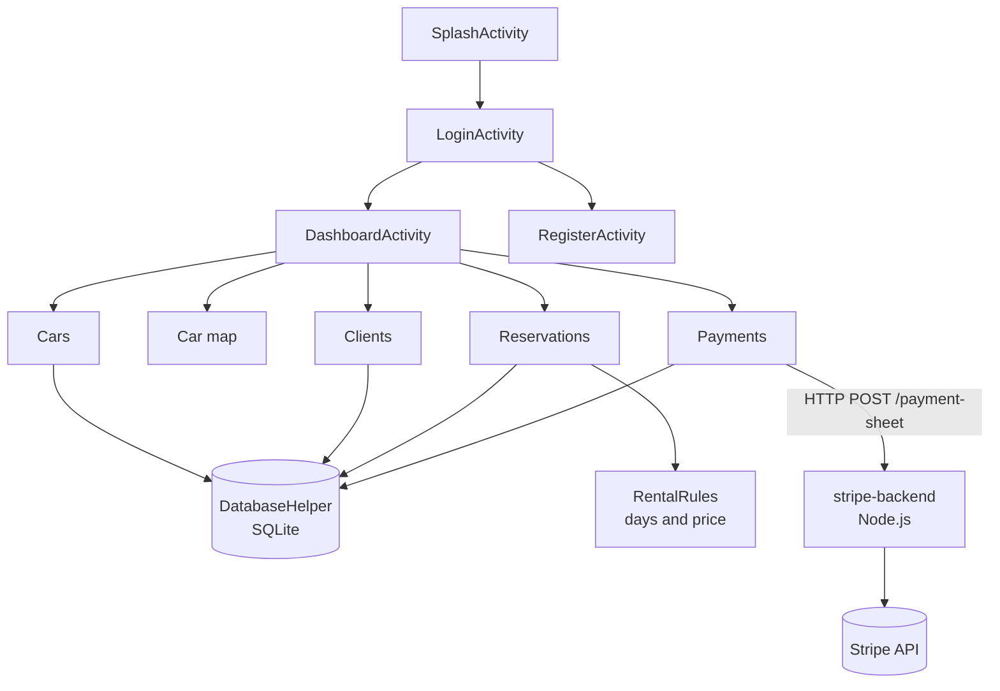

# DriveFlow — Android car rental management

Native Android application (Java, SQLite) for a small car rental agency, with three roles (administrator, employee, client), fleet management with photos and GPS position, reservations with overlap control, payments (manual and Stripe test mode) and local notifications.

> Academic / portfolio project (module "JEE & Android technologies"). All demo data is fictitious.

## Features (implemented)

| Area | What the app does |
|---|---|
| Accounts and roles | Login with hashed passwords; self-registration creates **Client** accounts only; session kept between launches; menus and actions adapted to the role |
| Fleet | Add / edit / delete cars (brand, model, year, daily price, availability flag, photo from the gallery, GPS position from the device); deletion refused while a car has reservations |
| Map | List of cars with a position, opened in the device's map application (`geo:` intent) |
| Clients | CRUD with unique e-mail; deletion refused while the client has reservations; a client account sees only its own profile and reservations |
| Reservations | Date pickers, price = days × daily price, start date not in the past, car not marked unavailable, **no overlap with a confirmed reservation**; statuses *pending → confirmed / cancelled / finished*; clients create pending requests that staff validate; only the administrator can delete |
| Payments | Partial payments with remaining balance; amount above the balance refused; online payment with **Stripe PaymentSheet** (test mode) through a small Node.js server; deletion of a reservation with payments refused |
| Dashboard | Counts of cars (available), clients, reservations by status and payments, adapted to the role |
| Notifications | Local notifications for new reservations and status changes |

## Tech stack

- Java 17, Android SDK 36 (minSdk 23), AndroidX AppCompat, Material Components, RecyclerView / CardView / ConstraintLayout
- SQLite through `SQLiteOpenHelper` (schema version 6)
- Stripe Android SDK 23.5 + `stripe-backend/` (Node.js, Express, `stripe`)
- Tests: JUnit 4 and Robolectric (test scope only)
- Build: Gradle 9.4.1, Android Gradle Plugin 9.1.0

## Architecture



Details, data model and rules: [`docs/ARCHITECTURE.md`](docs/ARCHITECTURE.md).

## Getting started

Requirements: Android Studio (recent, supporting AGP 9.1), JDK 17+, Android SDK Platform 36.

```bash
git clone <repository-url>
cd android-car-rental
./gradlew testDebugUnitTest      # Windows: gradlew.bat testDebugUnitTest
./gradlew assembleDebug
```

On first launch the app creates fictitious demo data (see below).

### Demo accounts — not secure, local testing only

| Role | Username | Password |
|---|---|---|
| Administrator | `admin` | `admin123` |
| Employee | `employe` | `employe123` |
| Client | `client` | `client123` |

> ⚠️ These accounts and passwords are **public and hard-coded** in `DatabaseHelper`, and passwords are hashed with unsalted SHA-256. They exist only to explore the app with fictitious data (clients `client.a@example.com`…, phone numbers `060000000x`). **Do not use this build with real customer data**: remove the demo accounts, use salted password hashing (e.g. PBKDF2) and set your own credentials first.

### Optional: Stripe test payments

```bash
cd stripe-backend
npm install
cp .env.example .env     # put your Stripe *test* keys in .env (never commit it)
npm start                # listens on http://localhost:4242
```

The Android emulator reaches the server at `http://10.0.2.2:4242`. Use a Stripe test card such as `4242 4242 4242 4242`. Manual payments work without the server.

## Tests

12 automated tests, last run locally on 2026-11-08 with `gradlew testDebugUnitTest assembleDebug` → **BUILD SUCCESSFUL, 12 passed, 0 failed**. See [`docs/TESTING.md`](docs/TESTING.md).

## Known limitations

- Stripe payments are recorded by the app when the PaymentSheet reports success; there is no server-side confirmation (webhook) yet.
- Passwords are hashed with SHA-256 without salt, and demo accounts are created automatically: fine for a demo, not for production.
- The server URL is the emulator address over plain HTTP.
- The availability flag of a car is a manual "unavailable" switch; date conflicts are handled by the overlap check.
- SQLite foreign keys are declared but not enforced; deletions are guarded in the application instead.
- Screenshots will be added with synthetic data.

## Development notes

Built as an academic project. Parts of the code were produced with the help of AI coding assistants and then reviewed, corrected and tested (see [`docs/CHANGELOG.md`](docs/CHANGELOG.md)).

## License

The original code of this project is released under the [MIT License](LICENSE).

The MIT License does **not** cover third-party material: the Gradle Wrapper (`gradlew`, `gradlew.bat`, `gradle/wrapper/`, Apache License 2.0), the npm packages referenced by `stripe-backend/package.json` and the libraries downloaded at build time, which keep their own licenses. See [`LICENSE`](LICENSE).
