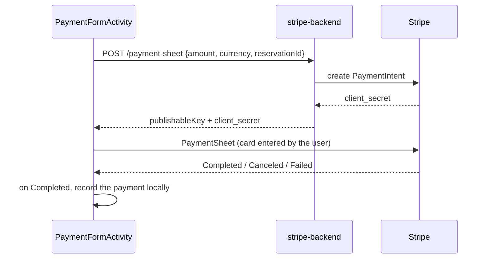

# Architecture

## Packages

| Package | Content |
|---|---|
| `com.example.locationvoitures.ui` | 13 activities (splash, login, register, dashboard, cars, car form, car map, clients, client form, reservations, reservation form, payments, payment form) and `NotificationUtils` |
| `com.example.locationvoitures.data` | `DatabaseHelper` (schema, migrations, queries, demo data), `RentalRules` (pure Java: days and price) |
| `com.example.locationvoitures.model` | `Car`, `Client`, `Reservation`, `Payment` |
| `stripe-backend/` | Express server creating Stripe PaymentIntents |

## Data model (SQLite, version 6)

```mermaid
erDiagram
    utilisateur ||--o| client : "user_id"
    client ||--o{ reservation : "client_id"
    voiture ||--o{ reservation : "voiture_id"
    reservation ||--o{ paiement : "reservation_id"
    utilisateur { int id PK; text username UK; text password_hash; text role }
    voiture { int id PK; text marque; text modele; int annee; real prix_jour; int disponible; real latitude; real longitude; text image_uri }
    client { int id PK; text nom; text prenom; text email; text telephone; int user_id FK }
    reservation { int id PK; int client_id FK; int voiture_id FK; text date_debut; text date_fin; real prix_total; text statut }
    paiement { int id PK; int reservation_id FK; real montant; text date_paiement }
```

On first launch, `DatabaseHelper` copies `assets/preloaded/location_voitures.db` if it exists; this file is **not** part of the repository, so a fresh build creates the schema and fictitious demo data in `onCreate`.

## Rules (as implemented)

- Rental days = calendar days between start and end, rounded so that a 23-hour night at a daylight-saving change is still one day (`RentalRules.daysBetween`). Price = days × daily price.
- A reservation is refused when it overlaps a **confirmed** reservation of the same car (`start < otherEnd AND end > otherStart`); returning a car on the day another rental starts is allowed.
- Client accounts can only create *pending* requests; staff confirm them, with the same overlap check.
- A payment cannot exceed the remaining balance of the reservation.
- Deletion is refused for a car with reservations, a client with reservations and a reservation with payments.

## Stripe flow (test mode)


